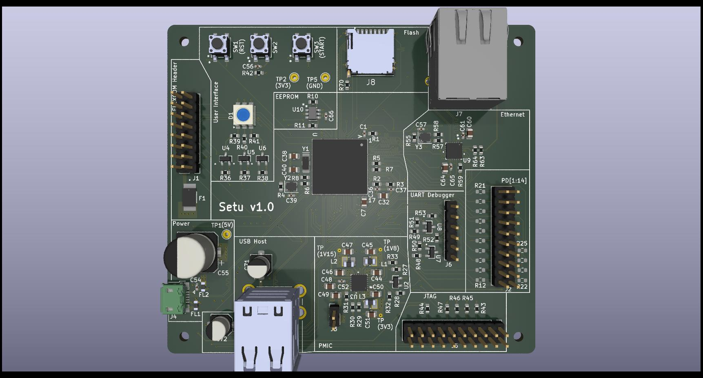
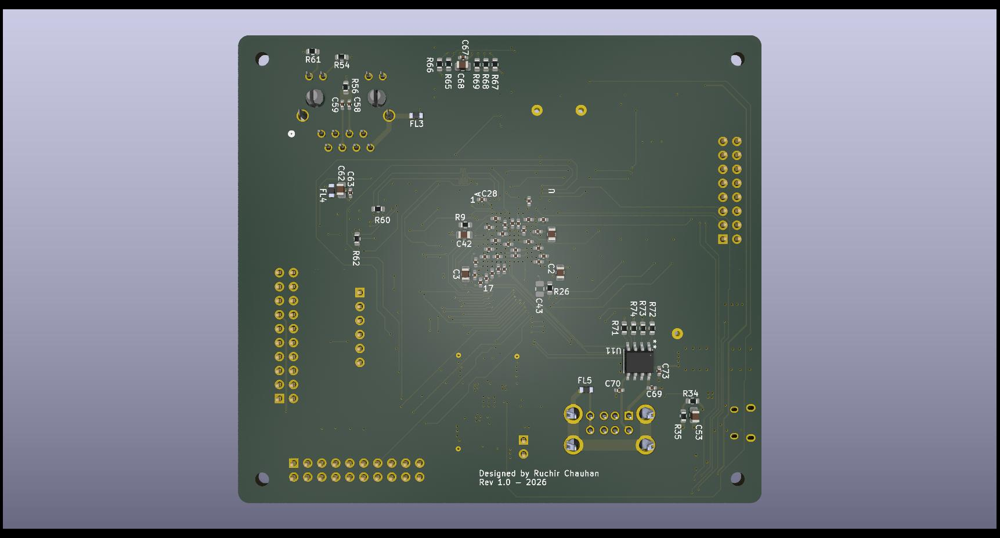
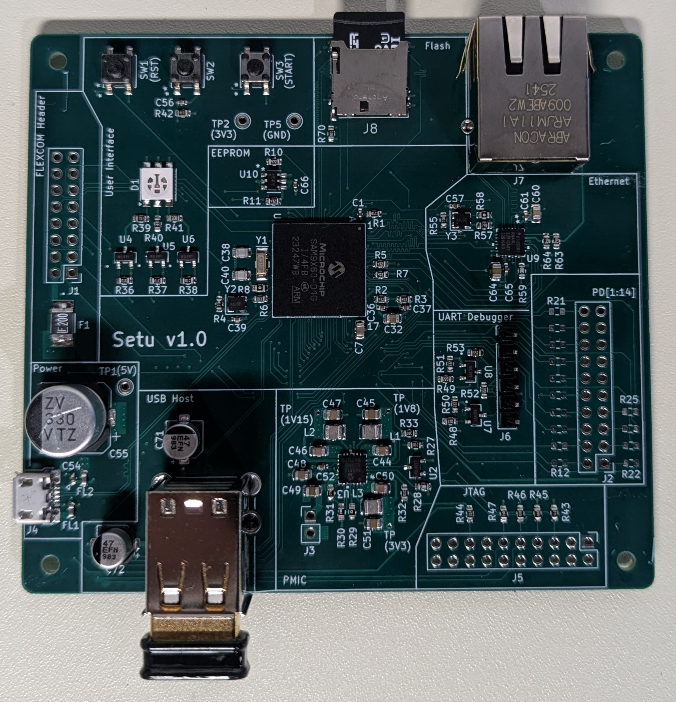
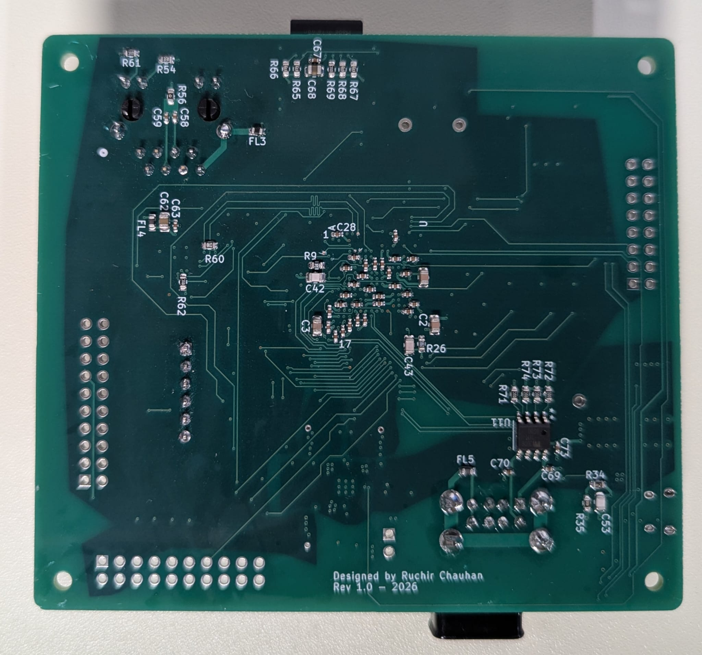

# Custom SAM9X60 Embedded Linux Development Board

A custom-designed embedded development board based on the **Microchip SAM9X60** ARM926EJ-S microprocessor, designed to explore embedded Linux, hardware design, and low-level software development.

The project started with the goal of designing a minimal, fully functional Linux-capable board using the SAM9X60, taking inspiration from Microchip's SAM9X60 Curiosity evaluation board.

## Software Repository

The Operating System and board-bringup related documentation are maintained separately:

**[Linux Board OS](https://github.com/ruchirchauhan/linux-board-os)**

## Board Images

### 3D PCB Render

### Actual PCB

## Hardware Overview

| Component | Description |
|---|---|
| Processor | Microchip SAM9X60D1G-I/4FB |
| Power Management | Microchip MCP16501 PMIC |
| Ethernet PHY | Microchip KSZ8081RNAIA-TR |
| Ethernet Interface | 10/100 Mbps RMII |
| Storage | MicroSD card |
| Debug Interface | UART via USB-to-serial adapter |
| Power Input | 5V USB |

## Software Repository

The corresponding software repository contains the bootloader, Linux kernel configuration, device tree, and Buildroot configuration used to bring up and run embedded Linux on this board.

TODO
<!-- TODO **Software repository:** [SAM9X60 Linux Software](https://github.com/TODO) -->

## Software

The board has been successfully brought up with:

- U-Boot bootloader
- Microchip Linux4SAM kernel
- Buildroot-based embedded Linux filesystem

## Current Status

**Hardware bring-up completed successfully.**

All onboard peripherals are operational, including:

- Ethernet connectivity
- UART console
- MicroSD storage
- USB interfaces

The board successfully boots embedded Linux from microSD and provides a functional platform for further embedded software development and experimentation.

## Repository Contents

This repository contains the hardware design files for the custom SAM9X60 development board, including PCB layout and associated design resources.

## Project Goals

- Explore custom embedded hardware design.
- Gain hands-on experience with ARM-based embedded Linux platforms.
- Experiment with bootloaders, Linux kernel configuration, and device drivers.
- Develop and test embedded applications on custom hardware.

## Acknowledgments

The hardware design was developed with reference to Microchip's SAM9X60 Curiosity evaluation board documentation and reference design.

- [Microchip SAM9X60 Product Page](https://www.microchip.com/en-us/product/sam9x60)
- [Microchip Linux4SAM](https://www.linux4sam.org/)

---